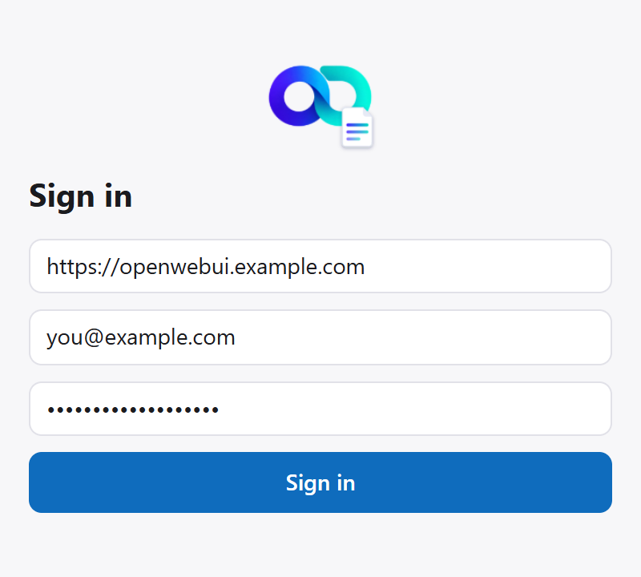
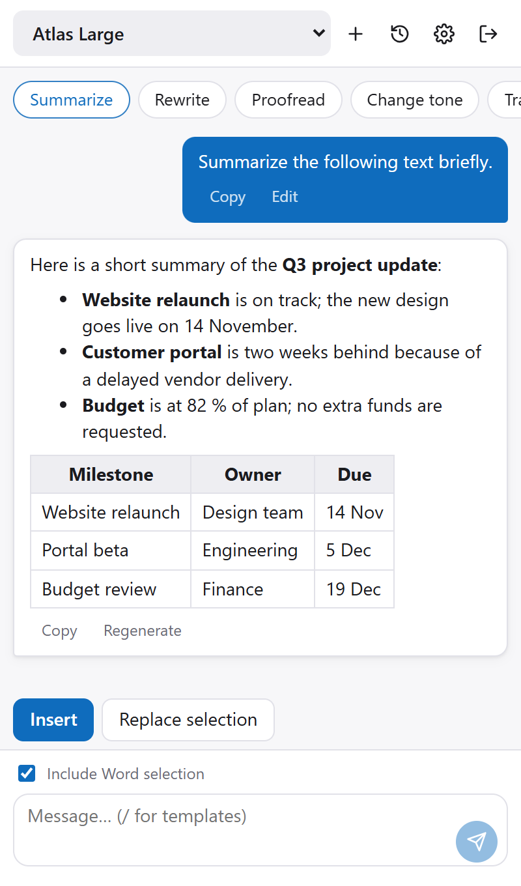
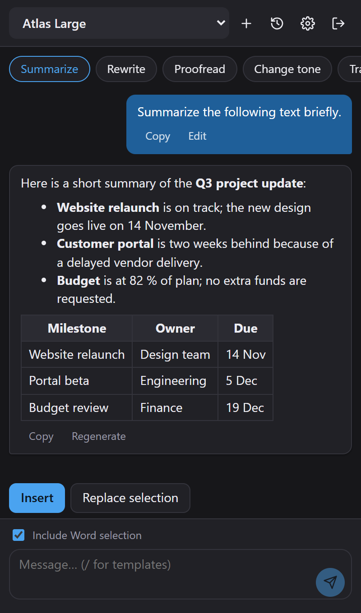

<div align="center">


# Open OfficeUI


**Your self-hosted Open WebUI, right inside Word, Outlook, Excel and PowerPoint**

[Screenshots](#screenshots) • [Features](#features) • [Installation](#installation) • [Requirements](#requirements) • [Development](#running-in-office-development) • [Known Limitations](#known-limitations)

</div>

---

Four Office task-pane add-ins that act as a chat client for your own **Open WebUI** server. They talk directly to the server's REST API - no cloud middleman - and work on what you have open: read the selection (or the whole document), ask the model, then insert or swap in the answer without leaving the application.

All four add-ins share one chat pane, so every feature below is available in Word, Outlook, Excel and PowerPoint alike. This is the Office sibling of [Open DesktopUI](https://github.com/markusbegerow/open-desktopui).

## Screenshots

The pane is shown here in Word, with fictional content and a mocked server.

<table>
  <tr>
    <td></td>
    <td></td>
    <td></td>
  </tr>
  <tr>
    <td align="center">Sign in</td>
    <td align="center">Chat (light)</td>
    <td align="center">Chat (dark)</td>
  </tr>
</table>

## Features

### 💬 Chat
- Streaming responses straight from your Open WebUI server, with a stop button
- Replies rendered as **Markdown**: lists, tables, links and syntax-highlighted code
- Model picker populated from your server
- **Document context**: the current selection (or, if nothing is selected, the content of the document) is sent along with your message - switch it off per message
- **Insert** the reply at the cursor, or **replace the selection** with it
- Per-message actions: copy, edit and resend, regenerate
- Local **chat history** with search (the last 50 chats, stored in the add-in)
- Optional **system prompt** and **temperature**

### 🧩 Prompt library
- Quick-action chips above the chat: summarize, rewrite, proofread, change tone, translate
- Edit, add and remove templates in Settings → Templates
- `{{variables}}` in a template are asked for before sending (for example `{{ton}}` or `{{sprache}}`)
- Type `/` in the message box to pick a template

### ⚙️ Settings
- German and English UI
- Light, dark or system theme
- Send with `Enter` or `Ctrl+Enter`
- An **About** tab with version, links, and a check for a newer release on GitHub

## The four add-ins

| Add-in | Port | What the host-specific part does |
| --- | --- | --- |
| Word | 3000 | Reads the selection or the document body; inserts at the cursor or replaces the selection |
| Outlook | 3001 | In compose mode writes into the mail body; when reading a mail it can only open a reply form |
| Excel | 3002 | Exchanges data as tab-separated text, one row per line, for reading the selection and for writing the reply |
| PowerPoint | 3003 | Insert adds a new last slide with a text box; replace changes the selected text. Reading all slides' text is the least verified path |

## Installation

The add-ins are hosted on GitHub Pages; you only need a manifest file.

1. Download the manifest for your app from the [install page](https://markusbegerow.github.io/open-officeui/) (or from the [latest release](https://github.com/markusbegerow/open-officeui/releases/latest)).
2. Add it to Office:
   - **Word, Excel, PowerPoint:** *Insert → Add-ins → My Add-ins → Upload My Add-in*
   - **Outlook:** *Get Add-ins → My add-ins → Custom add-ins → Add from file*
   - **Organisations:** Microsoft 365 admin center → *Integrated apps → Upload custom apps*, then assign users or groups
3. Allow the add-in on your Open WebUI server (see [Requirements](#requirements)), open the pane from the **Home** tab and sign in.

## Requirements

- Microsoft Office. Developed and tested on **Word for Windows**; the other three hosts and Office on the web are not as well tested
- A running [Open WebUI](https://github.com/open-webui/open-webui) server you have a URL and an account for. It must be served over **HTTPS** and allow the add-in origin via CORS, otherwise sign-in fails with a network error:

  ```
  CORS_ALLOW_ORIGIN=https://markusbegerow.github.io
  ```

  Only the origin, without a path. For development add the local ones: `https://localhost:3000;https://localhost:3001;https://localhost:3002;https://localhost:3003`.
- For development only: Node 24 and npm 11

## Running in Office (development)

Each add-in has its own fixed port and the development manifests hard-code it (`https://localhost:<port>`).

1. One-time: install the local HTTPS certificates. Vite reads them from `~/.office-addin-dev-certs`; without them it silently falls back to HTTP and Office rejects the pane.

   ```bash
   npx office-addin-dev-certs install
   ```

2. Install dependencies and start the dev server of the add-in you want (`word`, `outlook`, `excel` or `powerpoint`):

   ```bash
   npm install
   npm run dev -w @open-officeui/word
   ```

3. In a second terminal, sideload it into the desktop app:

   ```bash
   cd apps/word
   npx office-addin-debugging start manifest.xml desktop --app word --no-debug
   ```

   The pane opens from the **Home** tab. Stop with `npx office-addin-debugging stop manifest.xml`.

4. Sign in with your Open WebUI server URL, email and password.

Validate a manifest with `npx office-addin-manifest validate apps/<app>/manifest.xml`.

**Office on the web** should work in principle, since add-ins are plain web pages, but this has not been tried yet. Use `npx office-addin-debugging start manifest.xml web --document <document URL>` or *Insert → Add-ins → My Add-ins → Upload My Add-in* with the manifest.

## Development

```bash
npm install
npm test                                     # tests in every workspace that has them
npm run typecheck                            # tsc in every workspace
npm test -w @open-officeui/core -- src/sse.test.ts   # a single test file
npm run build -w @open-officeui/word         # production build of one add-in
npm run build:site                           # all four add-ins + production manifests + landing page into site/
npm run smoke                                # load the built site/ in headless Edge (run build:site first)
npm run logo                                 # re-render the logo and the add-in icons (needs Edge)
npm run screenshots                          # re-take docs/screenshots against a mocked server (needs Edge)
```

There is no configured linter. Tests cover pure logic only (the SSE parser, the chat client, prompt variables, history, translations); there are no component tests.

### Project structure

```
open-officeui/
├── packages/
│   ├── core/       # framework-free TypeScript: Open WebUI client, SSE parser, shared types, the HostAdapter interface
│   └── ui/         # the one React chat pane used by all four add-ins
└── apps/
    ├── word/       # thin shells: manifest.xml, vite.config.ts, src/main.tsx
    ├── outlook/    #   and src/<host>Adapter.ts implementing HostAdapter with Office.js
    ├── excel/
    └── powerpoint/
```

Dependencies point one way: `apps/*` → `packages/ui` → `packages/core`. The chat pane knows nothing about Office; everything host-specific goes through the `HostAdapter` interface (`getContext`, `insert`, `replaceSelection`, optionally `openUrl`). To add a host function, extend the interface and implement it in each adapter. UI strings live in `packages/ui/src/i18n.ts` and must be added in both languages.

The four app folders are near-identical copies (package.json, tsconfig, index.html, vite config). When you change shared boilerplate, apply it to all four. Changing a port means editing both `vite.config.ts` and every URL in the app's `manifest.xml`; the manifest `<Id>` GUIDs must stay unique per app.

### Releasing

Hosting and releases run on GitHub Actions (`.github/workflows/`):

- `ci.yml` type-checks, tests and builds everything on every push and pull request.
- `pages.yml` deploys `site/` to GitHub Pages on every push to `main`. One-time setup: repository *Settings → Pages → Source: GitHub Actions*.
- `release.yml` runs on a tag `vX.Y.Z` and attaches the production manifests to a GitHub release.

To publish a version: raise `version` in the root `package.json` **and** `VERSION` in `packages/ui/src/AboutTab.tsx` (a test checks they match; the manifest version must be at least 1.0.0), merge to `main`, then `git tag vX.Y.Z && git push origin vX.Y.Z`. The About tab's update hint reads the latest release.

The production manifests are generated from the development ones in `apps/*/manifest.xml` by replacing `https://localhost:<port>` with `<SITE_URL>/<app>`. `SITE_URL` defaults to `https://markusbegerow.github.io/open-officeui`; to serve from a custom domain, set the repository variable `SITE_URL` (users then need new manifests and the new CORS origin). The built pages carry a Content-Security-Policy meta tag; if a pane stays blank in Office, build with `SITE_CSP=off` to rule it out.

## Known Limitations

- **The sign-in token is stored unencrypted.** Settings, token and history live in `localStorage`. On GitHub Pages all four add-ins share one origin, so they also share sign-in, settings and history, and so does any other GitHub Pages site under the same account (`<user>.github.io`). A custom domain for the site gives the add-ins an origin of their own. *Settings → General → Delete all local data* removes everything from the browser profile.
- **History contains document text.** The selection or document that was sent with a message is stored with it in the local history.
- **Storage can be blocked in Office on the web.** Some browsers block `localStorage` in embedded pages; the add-in still works but forgets sign-in, settings and history.
- **History is local only.** There is no sync with your Open WebUI account, and no file attachments, Knowledge Bases or voice input yet.
- **The development manifests point at `https://localhost`.** The manifests you install come from `npm run build:site` and point at the hosted pages.
- **Replies are inserted as plain text.** There is no formatted insertion (headings, bold) and no tracked changes.
- **Outlook in read mode** can only open a reply form, not write into the mail.
- **Excel, PowerPoint and Outlook are less tested than Word**, and Office on the web is untested.

## Contributing

Contributions are welcome!

1. Fork the repository
2. Create your feature branch (`git checkout -b feature/amazing-feature`)
3. Commit your changes (`git commit -m 'Add amazing feature'`)
4. Push to the branch (`git push origin feature/amazing-feature`)
5. Open a Pull Request

## License

This project is licensed under the **GPL-3.0** - see [`LICENSE`](LICENSE) for the full text.

## Acknowledgments

- The [Open WebUI](https://github.com/open-webui) team, for Open WebUI itself
- Microsoft's [Office Add-ins](https://learn.microsoft.com/office/dev/add-ins/) platform and Office.js

## 🙋‍♂️ Get Involved

If you encounter any issues or have questions:
- 🐛 [Report bugs](https://github.com/markusbegerow/open-officeui/issues)
- 💡 [Request features](https://github.com/markusbegerow/open-officeui/issues)
- ⭐ Star the repo if you find it useful!

## ☕ Support the Project

If you like this project, support further development with a repost or coffee:

<a href="https://www.linkedin.com/sharing/share-offsite/?url=https://github.com/markusbegerow/open-officeui" target="_blank">  </a>

[](https://paypal.me/MarkusBegerow?country.x=DE&locale.x=de_DE)

## 📬 Contact

- 🌐 [Website](https://www.markus-begerow.de)
- 🧑‍💻 [LinkedIn](https://linkedin.com/in/markusbegerow)
- 💾 [GitHub](https://github.com/markusbegerow)
- ✉️ [Twitter](https://x.com/markusbegerow)
